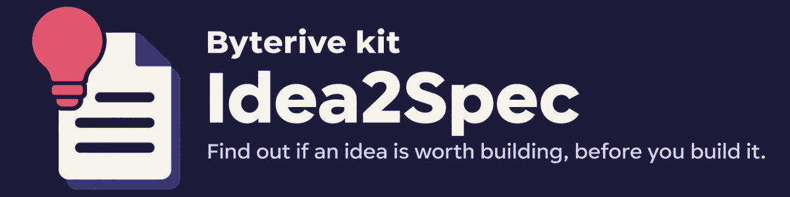
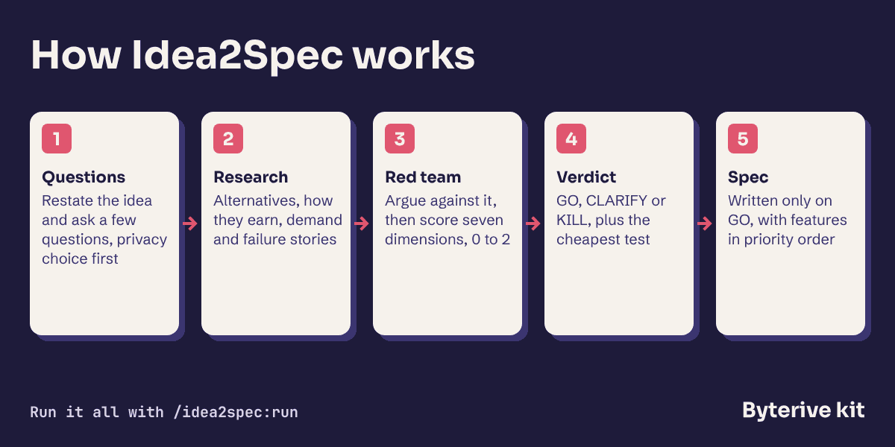
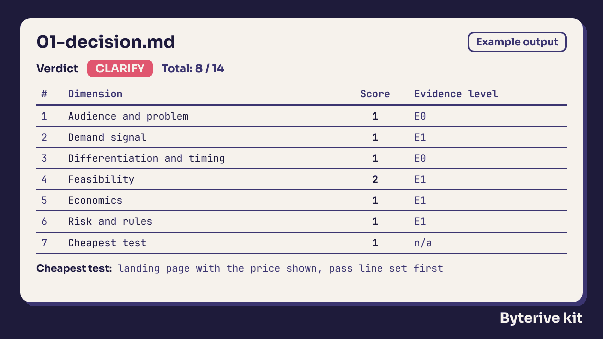

# idea2spec

Find out if an idea is worth building, before you build it.

Version 0.1.1 · early · MIT · Works with Claude Code

## What it does

We built idea2spec for the moment before the first line of code. You describe a rough idea: an app, a game, a YouTube channel, an affiliate site, a product or a service. The plugin asks a short set of questions, looks up the nearest alternatives and how they earn, argues against your idea, scores it, and gives you a verdict. It writes a spec only if the verdict is GO. The research and red-team agents search and fetch pages from the public web.

A KILL is a good outcome. It means you did not spend weeks on something the evidence did not support.

## How a run goes



1. **Questions.** It restates the idea and asks a few questions, scaled to how much is at stake. The first one is about privacy: it can search with generalized terms only (the default), with your exact wording, or not search the web at all.
2. **Research.** It looks for the nearest alternatives, how they earn money, demand signals and failure stories. Every fact is labelled READ (it opened the source), RECALLED (from memory) or UNVERIFIED. Only READ facts can lift a score.
3. **Red team and score.** It argues against the idea, then scores it 0 to 2 on seven dimensions, capped by the evidence you have.
4. **Verdict.** GO, CLARIFY or KILL, and always the cheapest test you could run next. Once you have real test results, `--after-test` gives PROCEED, ITERATE or KILL.
5. **Spec.** On GO, you get a spec with prioritized features. It asks before doing anything else.

## Install

```
/plugin marketplace add Byterive/kit
/plugin install idea2spec@byterive-kit
```

Then run `/idea2spec:run` and describe your idea.

## Try it

1. `/idea2spec:run` and then describe your idea
   It runs the full workflow one gate at a time. It shows the folder path and waits for your yes before the first file is written.
2. `/idea2spec:interview`
   It runs only the questions.
3. `/idea2spec:research`
   It runs only the web research and writes the evidence ledger.



## Commands

| command | what it does |
|---|---|
| `/idea2spec:run` | The full workflow, one gate at a time |
| `/idea2spec:interview` | Only the questions |
| `/idea2spec:research` | Only the web research and the evidence ledger |
| `/idea2spec:score` | Red team, scorecard and verdict. `--after-test` re-scores with real test results |
| `/idea2spec:improve` | After a KILL or CLARIFY: testable ways to improve the idea, each tied to evidence, plus a "stay killed" option |
| `/idea2spec:spec` | Writes the spec (needs a GO, or your recorded override) |
| `/idea2spec:review` | Checks the spec against a checklist |
| `/idea2spec:export` | Opt-in: a stories folder or an issues list, as local files |

## What you get

Files in `idea2spec/<NNN-slug>/`, in the folder where you ran it:

- `interview.md`: your answers, marked Settled, Clash or Unknown
- `00-evidence.md`: competitors, how they earn, and every claim with its label and source
- `01-decision.md`: the scorecard, the case against, the verdict, the cheapest test and the kill criteria
- `spec.md`: goal, audience, metrics, MVP scope, must, should and could features, requirements, monetization, risks, milestones and a validation plan

It shows you the folder path and waits for your yes before the first file is written.

## What it does not do

- It does not run code. The plugin ships as Markdown only (skills and agent definitions), with no scripts and no hooks.
- It does not build your idea, and it does not publish, post, email or upload anything. Export writes local files, only when you ask.
- It does not ask for passwords, API keys or tokens.
- It does not put your exact words in a search unless you say yes.
- It does not promise success. GO means the idea is worth running the cheapest test.

## Where it stands

This is version 0.1.1 and still early. The 10-of-14 GO threshold is a starting guess. In claude.ai chat and Cowork the plugin runs in lite mode, where one conversation does every step and a GO shows as "GO (unaudited)".

Research uses public pages and APIs, such as Hacker News, GitHub, the App Store search, Steam, npm and Wikipedia. They can change or block requests, and the plugin labels anything it could not read as UNVERIFIED.

Privacy: see [PRIVACY.md](PRIVACY.md).

## Licence

License: MIT. Copyright (c) 2026 Junaid Iqbal (Byterive).

Hacker News, GitHub, App Store, Steam, npm and Wikipedia are trademarks of their owners; this project is not affiliated with them.

*Independent project by Byterive. Not affiliated with or endorsed by Anthropic.* · [byterive.com](https://byterive.com)
